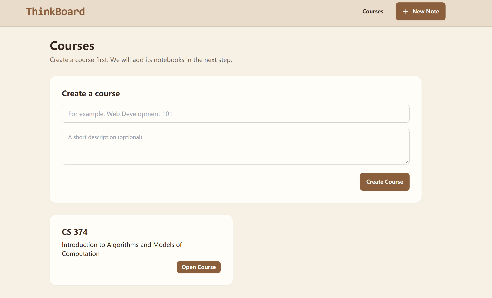
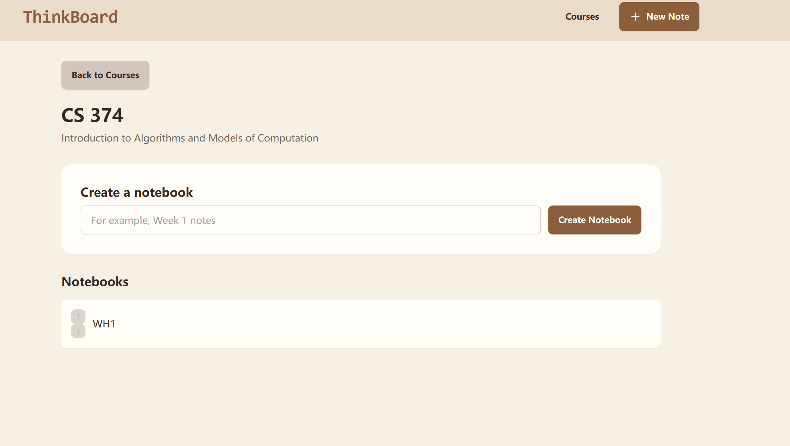
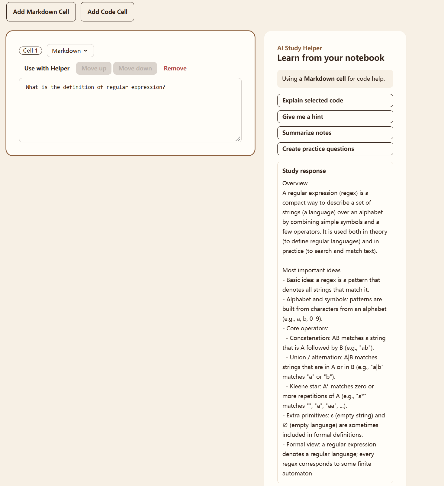
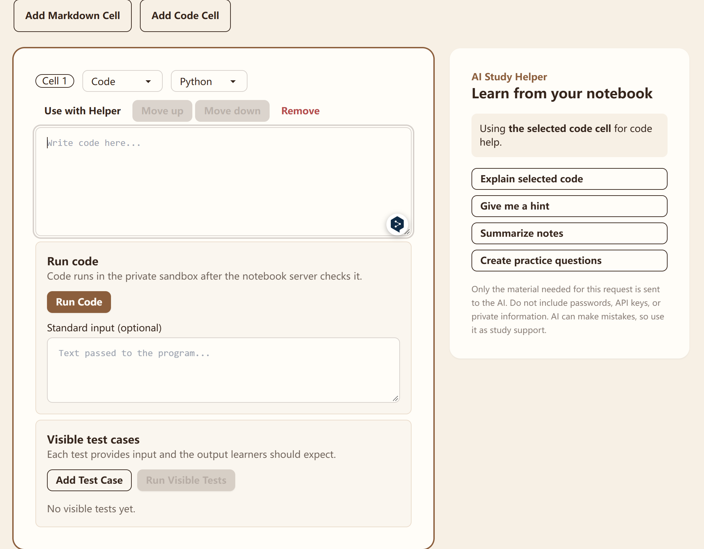

# Coursework Collection

Coursework Collection is a learning notebook app for organizing courses, writing notes, and practising code. It has a React frontend and an Express/MongoDB backend.

## Current capabilities

- Create, edit, and delete courses.
- Create, reorder, and delete notebooks within a course.
- Add Markdown and code cells to a notebook and save them to MongoDB.
- Run saved JavaScript and Python code cells through a configured Judge0 runner.
- Add up to 15 visible test cases to a code cell and see a pass/fail result for each one.
- Use the optional AI Study Helper to explain selected code, give hints, summarize notes, or create practice questions.

Authentication, grading, and collaboration are not implemented.

## Screenshots

### Courses



### Course notebooks



### Notebook and Study Helper



### Code runner and visible test cases



## Stack

### Frontend

- React 19
- Vite 8
- React Router 8
- Axios
- Tailwind CSS and DaisyUI
- Lucide icons and React Hot Toast

### Backend

- Node.js with ES modules
- Express 4
- MongoDB with Mongoose
- Upstash Redis and rate limiting
- Judge0 for remote code execution
- OpenAI SDK for the optional Study Helper
- Node's built-in test runner

## Requirements

- Current Node.js LTS and npm
- A MongoDB connection string
- Upstash Redis credentials (required for the application's rate limiting)
- A managed Judge0 account and language IDs (required to execute code)
- An OpenAI API key (optional; enables the Study Helper)

## Run locally

Open two PowerShell windows.

### 1. Configure and start the backend

```powershell
cd D:\Code\mern\backend
Copy-Item .env.example .env
```

Open `backend\.env` and provide the required values:

```env
PORT=5001
MONGO_URI=your_mongodb_connection_string
UPSTASH_REDIS_REST_URL=your_upstash_redis_url
UPSTASH_REDIS_REST_TOKEN=your_upstash_redis_token

# Required only for JavaScript/Python code execution
JUDGE0_BASE_URL=https://your-managed-judge0-endpoint
JUDGE0_AUTH_HEADER=X-Auth-Token
JUDGE0_AUTH_TOKEN=your_judge0_token
JUDGE0_JAVASCRIPT_LANGUAGE_ID=your_javascript_language_id
JUDGE0_PYTHON_LANGUAGE_ID=your_python_language_id

# Optional: enables the AI Study Helper
OPENAI_API_KEY=your_openai_api_key
```

Then install and start the API:

```powershell
npm install
npm run dev
```

The API listens on `http://localhost:5001`. It does not define a browser homepage; the frontend calls its `/api/...` routes.

### 2. Start the frontend

```powershell
cd D:\Code\mern\frontend
npm install
npm run dev
```

Open the URL shown by Vite, normally `http://localhost:5173`.

In development, the frontend is already configured to call `http://localhost:5001/api`.

## Run tests

The backend includes a unit test for the code-runner request, language selection, and execution limits.

```powershell
cd D:\Code\mern\backend
npm test
```

## Using code cells

1. Create a course and a notebook.
2. Add a code cell and select **JavaScript** or **Python**.
3. Save the notebook before running the cell.
4. Choose **Run** to execute the code, or add visible test cases and choose **Run Visible Tests**.

If Judge0 is not configured, ThinkBoard returns a clear `503` message rather than executing code locally.

## Code-execution safety

Submitted code is treated as untrusted. ThinkBoard sends it to a configured remote Judge0 runner; it does not execute it in the Express server process.

The application requests these limits for ordinary runs:

- 2 seconds CPU time and 3 seconds wall-clock time
- 128 MiB memory
- 32 processes or threads
- 1 MiB output file size
- 8-second request timeout

Visible tests use stricter per-test limits (1 second CPU, 1.5 seconds wall-clock) and a 15-second limit for the whole suite. Code is limited to 64 KiB; standard input and each visible test's input/output are limited to 8 KiB.

Judge0 credentials, MongoDB credentials, Upstash credentials, and OpenAI keys must remain in `backend/.env`. 

The limits above are requests sent to Judge0. Before offering code execution publicly, verify that your Judge0 provider also enforces network, file-system, and container isolation on its side.

## Project structure

```text
mern/
├── frontend/                 # React + Vite application
│   └── src/
│       ├── pages/            # Course, notebook, and note screens
│       └── components/       # Shared UI, including the Study Helper
├── backend/                  # Express API
│   ├── src/
│   │   ├── controllers/      # Course, notebook, note, and study actions
│   │   ├── models/           # MongoDB schemas
│   │   ├── routes/           # /api routes
│   │   ├── middleware/       # General, study, and execution rate limits
│   │   └── services/         # Judge0 code runner
│   └── test/                 # Node unit tests
└── README.md
```

## API overview

- `/api/courses` — course CRUD
- `/api/notebooks` — notebook CRUD, saved cells, reordering, code runs, and visible tests
- `/api/notes` — standalone note CRUD
- `/api/study` — optional AI Study Helper

## Troubleshooting

### `ENOENT: Could not read package.json`

Run npm commands inside `frontend` or `backend`, not from `D:\Code\mern`.

### The backend is running but the browser shows `Cannot GET /`

That is expected. Start the frontend separately and visit Vite's URL, usually `http://localhost:5173`.

### Code execution is not configured

Complete the Judge0 fields in `backend/.env`, including the JavaScript and Python language IDs provided by your Judge0 account.

### The Study Helper is unavailable

Add `OPENAI_API_KEY` to `backend/.env`. The rest of the application can run without it.
